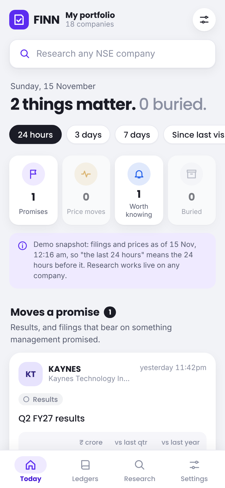
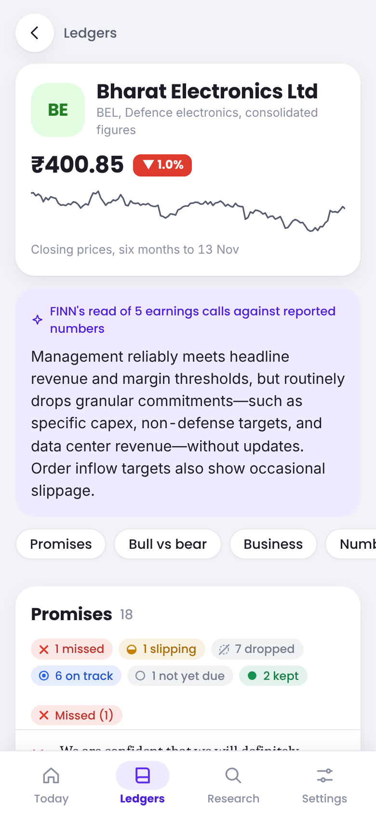
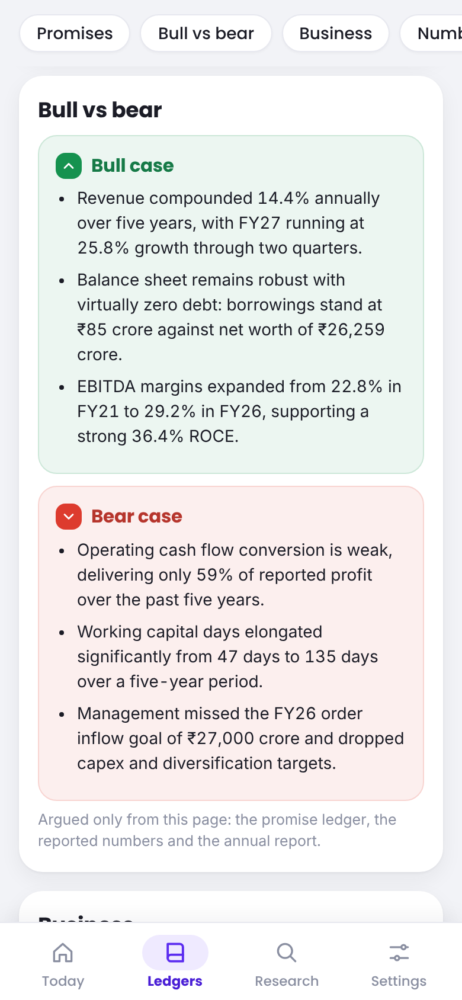
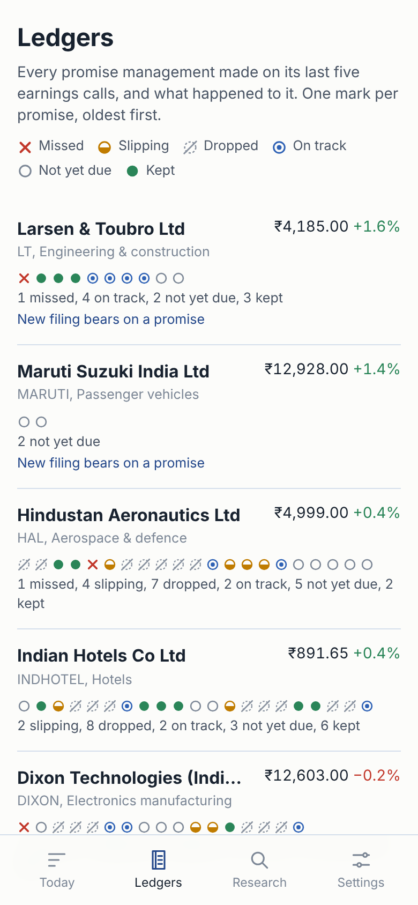

# FINN: a promise ledger for investors

**Live demo:** https://financial-investment-agent-finn.vercel.app (best on a phone)

<table>
  <tr>
    <td></td>
    <td></td>
    <td></td>
    <td></td>
  </tr>
  <tr>
    <td>Today: what moved a promise, the rest buried</td>
    <td>A company: FINN's read, then every promise</td>
    <td>Bull vs bear, argued from the page</td>
    <td>Every company's track record</td>
  </tr>
</table>

FINN keeps a ledger of what each company's management promised on its earnings calls
(growth, margins, capacity, orders, dates) and checks every promise against what was
actually reported. That ledger is how FINN decides what matters:

- **Push.** Results are always shown, with headline numbers checked against open
  promises. Any filing that bears on a promise comes next. After that come the filing
  categories you care about. Everything else is buried, counted and one tap away. Price
  or volume moves beyond your thresholds are paired with the filings that explain them,
  and a move with no filing behind it is shown on its own. The window is the last 24
  hours, 3 or 7 days, since your last visit, or any dates you pick. Management changes
  carry the appointee's background from the filing; when the filing has none, FINN
  looks it up on the web and labels it as such, with its sources.
- **Pull.** Type any NSE symbol. FINN reads the last five earnings-call transcripts,
  lists the promises, follows each one through later calls (repeated, raised, cut,
  delivered, or quietly dropped), and checks the numeric ones against exchange-reported
  results. It also reads the latest annual report for what the business does and how
  its revenue splits.

Each company page then has, in order: the promise ledger and a credibility read; a
bull case and a bear case argued only from that page's facts; the business snapshot;
ten years of revenue, profit and margins with key ratios; the balance sheet (debt,
interest cover, working-capital days); and cash quality (operating cash against
reported profit, year by year). The figures are computed in code from exchange-filed
numbers, not by the model.

Primary sources only: exchange filings, earnings-call transcripts and exchange-reported
numbers. No news, broker notes or model memory.

## About the demo data

The deployed app shows a **frozen snapshot of real data as of 15 Nov 2026, 12:16 am IST**,
just after the last filing before the data was collected that afternoon:

- **Promise ledgers** from the last five earnings calls of 18 NSE companies, plus 5 more prepared for research.
- **Exchange filings** from the previous 30 days: 212 of them.
- **Prices**: six months of daily closing prices and volumes.
- **Company pages**: business snapshots read from each latest annual report, bull and bear
  cases, ten-year figures, balance sheet and cash quality.

Times in the app ("the last 24 hours") are measured from that moment, and a note on the
Today screen says so. Freezing the data keeps the demo stable and inside free-tier limits.

**What stays live:** the Research tab. Type any NSE symbol and FINN reads its transcripts
and builds the ledger on demand.

**To switch to live data:** go to GitHub, then Actions → finn-data → Run workflow. A full refresh takes about 45 minutes on
the free tier and turns snapshot mode off. `python -m pipeline.freeze` turns it back on
(`--latest` sets the clock just after the newest filing). To refresh
automatically, add a schedule to `.github/workflows/finn-data.yml`; the file shows how.

**Known gaps in the snapshot:**
- Trent holds no earnings calls, so it has no promises; its bull and bear cases come from its figures alone.
- HDFC Bank gives no numeric guidance, so it has no promises either.
- Maruti's older transcripts sit on its own website, which refused the download.
- Where a results PDF could not be read cleanly, the card uses the exchange's quarterly
  figures and says so.
- On the day of the final run, Flash's free tier allowed one call: BEL's bull and bear
  cases were written by Flash, the others by Flash-Lite. A later run retries Flash.
- Web backgrounds for appointees whose filing has no profile are built, but Google's
  free tier refused every search-grounded call, so none appear in this snapshot.

---

## Run it yourself

```bash
python -m venv .venv && source .venv/bin/activate
pip install -r requirements-pipeline.txt
export GEMINI_API_KEY=...        # free key from https://aistudio.google.com/apikey
python -m pipeline.doctor INFY   # checks every data source; saves raw pages to dev/samples on failure
python -m pipeline.run --mode full --only INFY
python dev/server.py             # http://localhost:8000
```

On Windows (PowerShell), one script does all of it and publishes the data:
`powershell -ExecutionPolicy Bypass -File scripts\run-local.ps1` (add `-Doctor` to only check sources).

A full refresh of the whole portfolio is paced to stay inside the Gemini free tier, so the
first run takes 30–50 minutes. A run stops starting new model reads when its time budget
is spent (`FINN_TIME_BUDGET_MIN`, default 35) and saves what it has; because every read is
cached, the next run continues where it stopped.

## Deploy

1. Push this repo to GitHub (public, so Actions minutes are free).
2. In the repo settings, add the Actions secret `GEMINI_API_KEY`, and under Actions set
   workflow permissions to "Read and write" so the data job can commit.
   `.github/workflows/finn-data.yml` runs when you start it (Actions → finn-data → Run
   workflow); add the schedule shown in the file to refresh automatically.
3. In Vercel, import the repo with the **Python** preset. Add the environment variable
   `GEMINI_API_KEY` and deploy. `app.py` is the entry point: one WSGI app serving the
   research API at `/api/*`; the static app in `public/` is served by Vercel's CDN.
4. Check `https://<your-app>/api/company?t=INFY` returns JSON, then open the app on a
   phone.

If the exchanges block GitHub's servers, refresh from a laptop instead (Windows):
`powershell -ExecutionPolicy Bypass -File scripts\run-local.ps1` runs the pipeline and
pushes the data in one step.

## How it is built

```
GitHub Action (on demand)                                 Vercel
  pipeline/run.py                                           public/  static app (no build step)
    screener.in  -> quarterly and annual numbers,           app.py -> finn/web.py:
                    transcript and annual-report links        GET  /api/company          any NSE ticker
    BSE / NSE    -> filings                                   POST /api/ledger_step      reads one call
    Yahoo        -> end-of-day price and volume               POST /api/business         reads the annual report
    Gemini       -> reads PDFs (cached forever)               POST /api/ledger_finalize  rules + verdict + bull/bear
  writes public/data/*.json  --commit-->  redeploy
```

| Step | How | Why |
|---|---|---|
| Classify filings | Rules on exchange labels and headlines; one batched model call for leftovers | Most filings need no model at all |
| Read transcripts, results, management-change filings, annual reports | `gemini-3.5-flash-lite` (free tier, ~500/day) | Bulk extraction; the cheap model is enough |
| Results lines the first read missed | A second Flash-Lite pass on the text of the statement pages only; then a check against the exchange's quarterly table | A misread card is worse than a late one |
| Annual report | Code picks the ~14 pages about the business and segments; Flash-Lite reads only those | A 300-page PDF does not fit the free tier; the right 14 pages do |
| Appointee background missing from the filing | Flash-Lite with Google Search grounding; shown only with sources, and labelled | Best effort; "UNKNOWN" is an allowed answer. The free tier currently refuses these calls |
| Promise verdicts, credibility read, bull and bear | `gemini-3.8-flash` (free tier, ~20/day), falls back to Flash-Lite | The one step that needs judgment, once per company |
| Arithmetic (QoQ, YoY, EBITDA, margins, CAGR, debt/equity, cash conversion, promise checks) | Plain Python | Models extract numbers; code does the maths |
| Status of each promise | Explicit rules in `finn/ledger.py` | Explainable; the model may override only with a stated reason |

Every model output is cached by (task, document, prompt version) in `public/data/cache`,
and the API reads that cache from the deployed bundle. So no document is ever read
twice. Routes can be overridden with `FINN_MODEL_<TASK>`. Usage per run is shown in the
app under Settings.

## Tests

```bash
pytest                                   # parsers, maths, ledger rules, model routing, API, full pipeline
node --test tests/js/logic.test.mjs      # the digest's ranking and move pairing in the browser
python dev/make_fixtures.py && python dev/server.py --fake   # open /?fixtures (fictional data)
```

`dev/fakes.py` contains fictional companies, filings and a scripted model, so the real
pipeline and API run end to end offline. None of it is deployed.

## Layout

```
finn/            library: sources, Gemini client, classifier, ledger, triage, maths,
                 fundamentals (annual figures), business (annual-report snapshot)
app.py           Vercel entry point (WSGI app: research API, static fallback)
pipeline/        run.py (scheduled refresh), doctor.py (day-1 checks)
public/          the app: index.html, css/, js/ (no framework, no build)
config/          portfolio and announcement categories
tests/, dev/     tests, fakes, dev server, screenshot script
```
